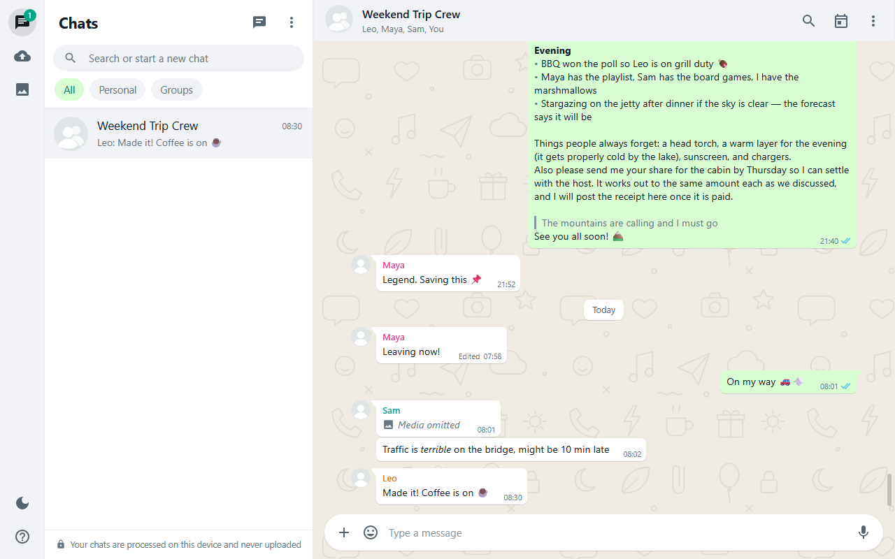
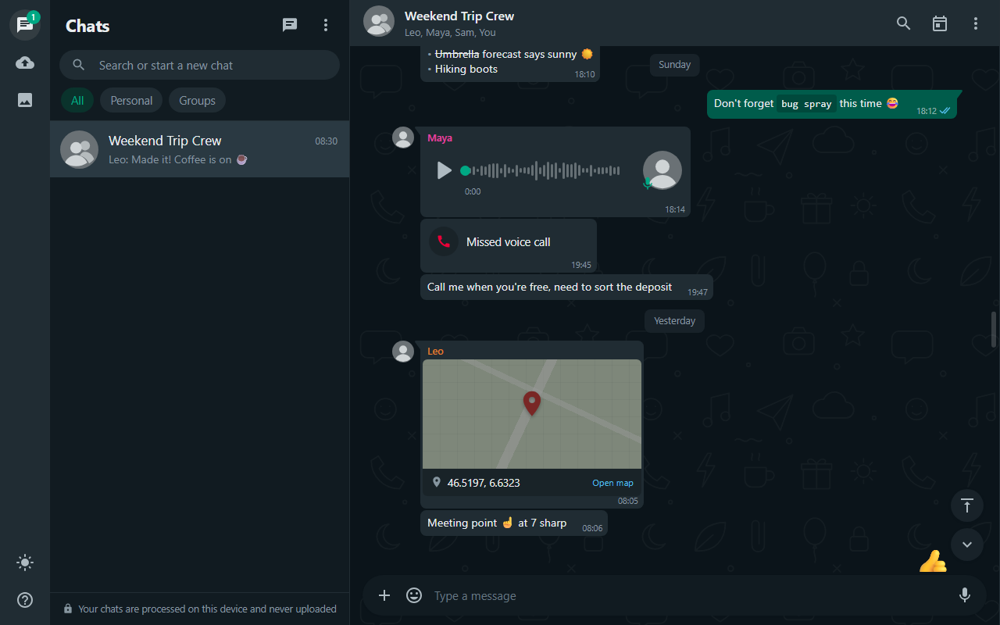
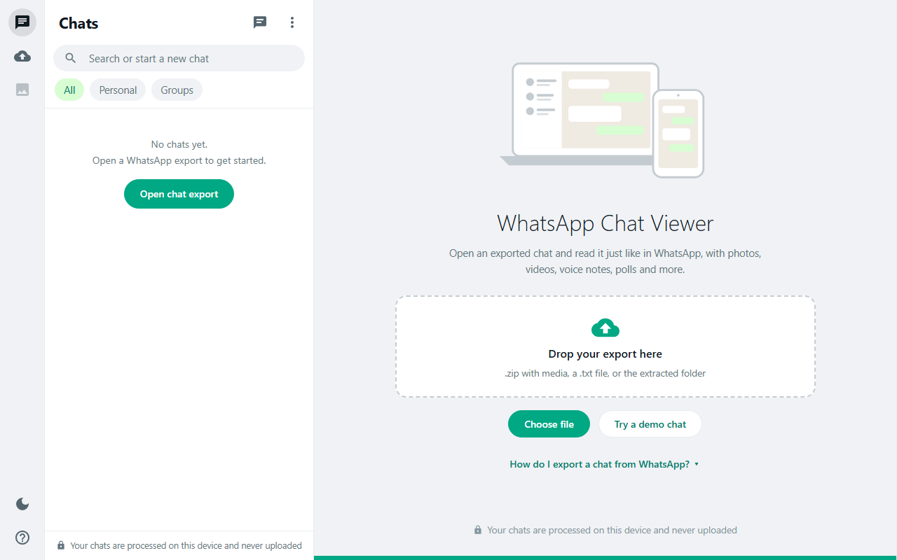
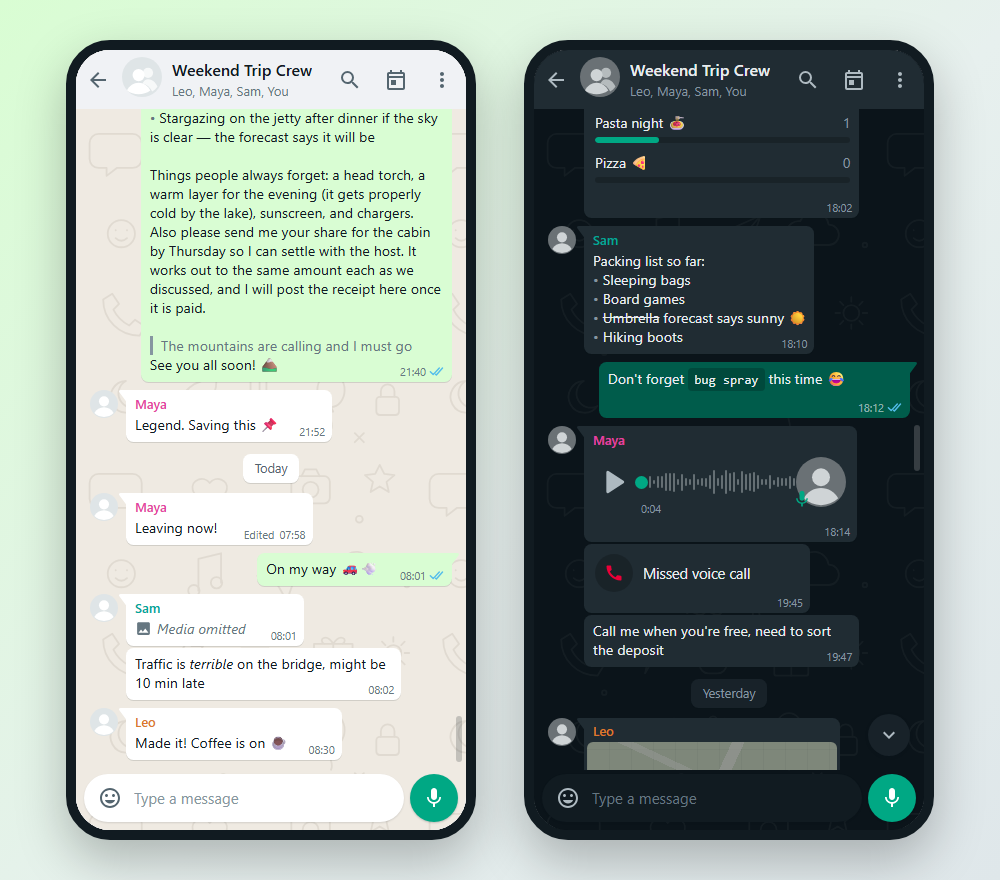
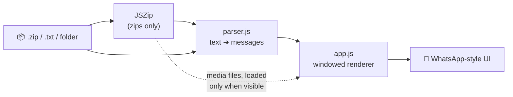

<div align="center">



# WhatsApp Chat Viewer

**Read exported WhatsApp chats in a familiar WhatsApp-style interface: private, fast and fully in-browser.**

[](https://YOUR-USERNAME.github.io/YOUR-REPO/#demo)
[](#-quick-start)
[](#-privacy)

[Quick start](#-quick-start) · [Features](#-features) · [Screenshots](#-screenshots) · [How it works](#-how-it-works) · [Shortcuts](#-keyboard-shortcuts) · [FAQ](#-faq)

</div>

> [!TIP]
> Add `#demo` to the address (e.g. `index.html#demo`) to open a sample group chat with photos, a voice note, a poll and more.

---

## 🚀 Quick start

<table>
<tr>
<td width="50%" valign="top">

**Option 1: just open it**

1. Download or clone this repo
2. Double-click **`index.html`**
3. Drop your exported `.zip` or `.txt` on the page

</td>
<td width="50%" valign="top">

**Option 2: serve it locally**

```bash
git clone https://github.com/YOUR-USERNAME/YOUR-REPO.git
cd YOUR-REPO
npx serve .
```

Then open the printed URL.

</td>
</tr>
</table>

<details>
<summary><b>📱 How do I export a chat from WhatsApp?</b></summary>
<br>

| | Android | iPhone |
|---|---|---|
| 1 | Open the chat and tap **⋮** | Open the chat and tap the **contact or group name** |
| 2 | **More → Export chat** | Scroll down to **Export Chat** |
| 3 | Choose **Include media** | Choose **Attach Media** |
| 4 | Save the `.zip` | Save to Files |

Then open the `.zip` in the viewer. You can also drop a plain `.txt` export, or the extracted folder.

</details>

<details>
<summary><b>🌐 Publish your own live demo with GitHub Pages</b></summary>
<br>

1. Push this repo to GitHub
2. Go to **Settings → Pages**
3. Set **Source** to *Deploy from a branch*, choose `main` and `/ (root)`
4. Wait a minute, then open `https://YOUR-USERNAME.github.io/YOUR-REPO/#demo`
5. Replace `YOUR-USERNAME/YOUR-REPO` in this README's links with your own

</details>

---

## ✨ Features

<details open>
<summary><b>💬 Looks like the real app</b></summary>

- Bubbles with tails, grouped messages, read ticks, **Edited** labels
- Coloured sender names and avatars in group chats
- Date separators (*Today*, *Yesterday*, weekdays) plus a floating date while scrolling
- The classic doodle wallpaper, light **and** dark themes (follows your system)
- Desktop layout like WhatsApp Web; full-screen phone layout on mobile with back-button support

</details>

<details>
<summary><b>🖼️ Every kind of message</b></summary>

| Type | What you get |
|---|---|
| Photos | Inline previews, full-screen viewer with swipe / arrow keys and download |
| Videos | Inline player |
| Voice notes | Waveform player with seek and **1× / 1.5× / 2×** speed |
| Stickers, GIFs | Shown without a bubble, like WhatsApp |
| Documents & contacts | File cards with download; vCard names are read from the file |
| Polls | Options with vote bars |
| Locations | Map card that opens in your maps app |
| Calls, deleted & omitted media | Shown the way WhatsApp shows them |
| Formatting | `*bold*`, `_italic_`, `~strike~`, ```` ```mono``` ````, quotes, lists and clickable links |

</details>

<details>
<summary><b>🧭 Navigate huge chats</b></summary>

- **Fast-scroll bar**: drag it to jump anywhere in years of history; a date bubble shows where you'll land
- **Go to first / latest message** buttons, plus <kbd>Home</kbd> / <kbd>End</kbd>
- **Jump to date** with a calendar
- **Search** with highlighted matches and next / previous navigation
- 100,000+ messages open instantly: only a window of messages is kept on the page

</details>

<details>
<summary><b>🛠️ Tools</b></summary>

- **Chat info**: message counts, busiest day, top participants and a media gallery
- **Who is "You"?** Pick which participant appears on the right, or swap sides
- Message menu: **copy**, **copy with sender & time**, **download**, **message info**
- Open several chats at once and filter them by **All / Personal / Groups**
- Add missing media files to an already-open chat
- Android **and** iPhone exports, 12/24-hour clocks and DD/MM, MM/DD or YYYY-MM-DD dates

</details>

---

## 📸 Screenshots

<table>
<tr>
<td align="center" width="50%"><br><sub>Dark mode: voice notes, calls, locations</sub></td>
<td align="center" width="50%"><br><sub>Drop a .zip, a .txt or a folder</sub></td>
</tr>
<tr>
<td align="center" colspan="2"><br><sub>Mobile layout</sub></td>
</tr>
</table>

---

## ⚙️ How it works



<details>
<summary><b>Project structure</b></summary>

```text
├── index.html            Page shell and icons
├── css/styles.css        Theme tokens (light / dark) and layout
├── js/parser.js          Export text ➜ message objects (Android + iPhone, many locales)
├── js/format.js          WhatsApp text formatting and link detection
├── js/app.js             UI, windowed rendering, media, search, voice player
├── js/demo.js            Built-in sample chat
└── docs/screenshots/     Images used in this README
```

</details>

<details>
<summary><b>Why it stays smooth with huge chats</b></summary>

The DOM never holds the whole chat. A sliding window of at most ~480 rows is rendered, and rows are added or removed at the edges as you scroll while keeping your reading position steady. Photos and videos are only unpacked from the zip when they come near the screen. The fast-scroll bar maps the *entire* chat, not just the rendered window, so you can still jump anywhere.

</details>

---

## ⌨️ Keyboard shortcuts

| Keys | Action |
|---|---|
| <kbd>Ctrl</kbd> / <kbd>⌘</kbd> + <kbd>F</kbd> | Search messages |
| <kbd>Enter</kbd> / <kbd>Shift</kbd> + <kbd>Enter</kbd> | Older / newer search match |
| <kbd>Home</kbd> / <kbd>End</kbd> | First / latest message |
| <kbd>←</kbd> <kbd>→</kbd> | Previous / next photo in the viewer |
| <kbd>Esc</kbd> | Close viewer, dialog, menu or panel |

---

## 🔒 Privacy

Everything happens **inside your browser**. Your chat is read from your disk with JavaScript and is **never uploaded**: there is no server, no analytics and no account. The only network request loads the [JSZip](https://stuk.github.io/jszip/) library from a CDN to open `.zip` files, so `.txt` exports work completely offline.

---

## ❓ FAQ

<details>
<summary><b>My messages appear on the wrong side</b></summary>
<br>
Exports don't say who exported them. Open the <b>⋮ menu → Choose who is "You"</b> (or <b>Swap sides</b> in one-to-one chats).
</details>

<details>
<summary><b>The dates look wrong (e.g. 3 February instead of 2 March)</b></summary>
<br>
Some exports are ambiguous about day/month order. Open <b>Chat info</b> and switch the <b>Date format</b> between DD/MM and MM/DD.
</details>

<details>
<summary><b>Photos or voice notes are missing</b></summary>
<br>
Export with <b>Include media</b> / <b>Attach Media</b> and open the <code>.zip</code>. If you already opened a <code>.txt</code>, use <b>⋮ → Add media files…</b> to attach the files afterwards.
</details>

<details>
<summary><b>A voice note won't play</b></summary>
<br>
WhatsApp voice notes are <code>.opus</code> files. Chrome, Edge and Firefox play them; some older Safari versions can't. Use <b>Download</b> from the message menu to play them elsewhere.
</details>

<details>
<summary><b>Does it work offline?</b></summary>
<br>
Yes for <code>.txt</code> exports. Opening <code>.zip</code> files needs the JSZip library from the CDN once; after that your browser usually caches it.
</details>

---

<div align="center">
<sub>Not affiliated with WhatsApp or Meta. "WhatsApp" is a trademark of its respective owner.</sub>
</div>
